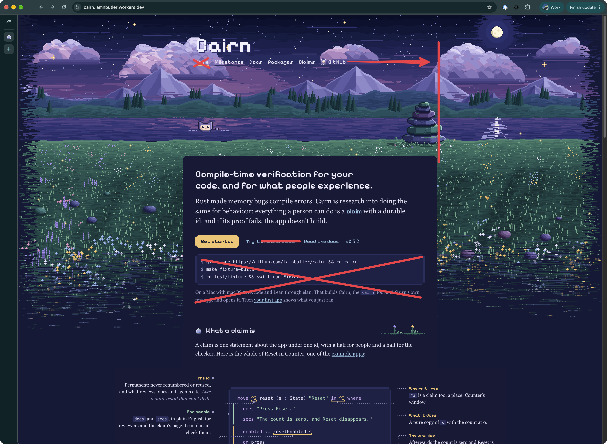
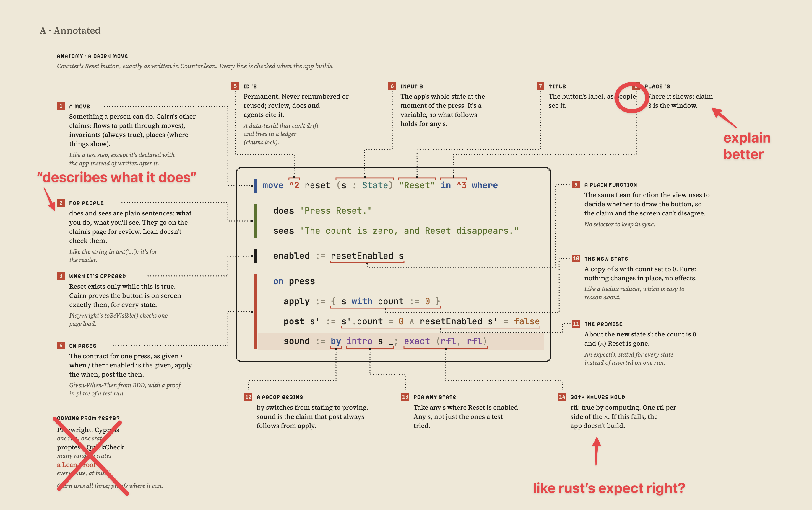

# How I work

I don't write code now; agents write all of it. My part is deciding what to build, reacting to what the agents make, and reviewing it. This document describes how that works day to day, and the rules I give agents so the work stays correct and I can trust what they report.

## What I build

Most of what I build is prototypes, research and experiments. I work on the first 10 to 20 percent of something, enough to present the idea and see whether it holds up. I'm not building production apps, except for things at a personal scale that only I or my household use.

That shapes most of what follows. The goal is to get an idea working on real systems quickly, learn from it, and show it to people. Long-term maintenance, backwards compatibility and scale mostly don't apply, and where a rule below would be different for a production app, I've said so.

## Don't ask me questions

This goes against most current advice on working with agents. I don't want to be asked questions, and I don't want the agent to stop and confirm things. Build it end to end, then we talk about what you built. I believe in experiencing things and iterating from there.

A finished first version with a few wrong guesses is more useful to me than a partial one waiting on my answers, because I can react to a guess. With a prototype, a wrong guess is cheap to change. When a choice is hard, make it, write down what you chose, and keep going.

## The setup

- I work almost entirely in Claude Code. I use Codex only as a backup for computer use, through `codex --yolo app`.
- Most work happens in a single long-running agent thread. When a line of work needs it, that thread opens one or two more threads and delegates to them. Threads message each other through [telephone](https://github.com/iamnbutler/telephone), and I message them from my phone through [margin](https://github.com/iamnbutler/margin).
- Each agent works in its own git worktree. Every change in every repo goes through [lane](https://lane.lukeed.com): `lane new`, work in the tree, open a PR, squash-merge, `lane rm`. When agents share a checkout, their changes get mixed together and `git add -A` picks up another agent's unfinished files.
- A second Mac handles anything that needs a separate machine: multiplayer testing, installing a release somewhere other than the build machine, and AI testers driving apps overnight. Agents reach it through [porthole](https://github.com/iamnbutler/porthole).
- Agents operate Mac apps through [desktop-tools](https://github.com/githubnext/desktop-tools), not through AppleScript or their own event-injection code.
- Large files (traces, recordings, datasets) go on a NAS. The laptop's disk is shared by every agent and fills up quickly.
- I dictate most of my messages to agents with [yap](https://github.com/iamnbutler/yap).

## Languages and frameworks

- I work in whatever language is most convenient for the project, not the one I know best. Since agents write the code, the question is which language gets the idea working fastest on the platform it needs.
- Right now that's mostly Swift, because a lot of my work is on macOS, iOS and system APIs.
- I use Rust much less than I used to, because of its long compile times. I still pick it when I want its testing or doc tests.
- I don't use TypeScript desktop frameworks like Electron or Electrobun anymore, except in legacy apps.
- I avoid frameworks with large dependency stacks, such as GPUI, for now.

## Starting something

- I share the idea, the agent builds the first version, and I react to it. The brief is usually a sentence or two. I don't write a spec or a plan first, because I work out what I want by using something that exists.
- Most of my input comes after that first version: what's wrong, what to remove, what to try next. Each round responds to the previous one rather than following a plan.
- Anything I didn't specify is the agent's decision. It picks something reasonable, notes what it picked, and continues.
- When there's relevant prior art, such as engineering blogs, existing calculators, or a codebase I'm forking, agents first write sourced notes on it in the repo. The first version is then checked against those notes. For research projects, these notes are often as much of the result as the code.
- When an agent says some data isn't available, it usually is. It should look harder, scrape it, or port it from an existing tool before working around it.
- For the few things that must be correct even in a prototype, such as a process supervisor that upgrades running VMs, I ask for a formal spec instead of a plan. The spec describes the system: goals, non-goals, a state machine, invariants and a failure model. The build then goes in small steps, each followed by a review that tries to break it.

## Design

- For a new visual direction, I ask for three or four that are very different from each other, each built for real and viewable side by side. I'm much better at reacting to something on screen than at describing what I want, and directions that are only variations of one idea don't tell us much.
- My feedback is short and specific: which directions to drop and which to keep. When I share a reference, I say which attribute it's for. A colour reference should change the colours and nothing else.
- Most visual feedback goes as an annotated screenshot. I mark up a screenshot in [CleanShot X](https://cleanshot.com) and paste it to the agent: a red X over anything to remove, a line through text to cut, an arrow and a line to show where something should extend to, a circle around the exact spot I mean, and a few words of handwritten-style text for the change or question ("explain better", "like Rust's expect, right?"). It's faster than describing where something is, and the agent can see exactly what I'm pointing at.

   
- Every pass and fork is kept. The final result is often parts of two directions combined, which needs both to still exist.
- During long design work, the agent keeps a document of my positive and negative feedback, because context compaction loses it otherwise.
- Current agents are overtrained on marketing sites, so they tend to build tools like one: a hero, descriptive sections, features split into separate pitch blocks. A tool doesn't need any of that. Its page should show the tool and its data.
- When I want something unconventional, I state the defaults as rules to break, for example "no rectangles". Asking an agent to "be creative" doesn't change its output much.
- I give inspiration the agent can't copy UI from. A photo of a concrete wall can inform tone and texture, but it contains no UI patterns to reuse. A screenshot of another product's UI tends to get copied directly, including its bad patterns.
- Mobile layouts, performance work and copy come after we've chosen a direction, and only if the prototype needs them to make its point.

## Handing work off

- Overnight and unattended runs work from GitHub issues, so the backlog has to be good. I start with a gap-analysis session, and each resulting issue should give a worker enough to start without asking: a title that states the change, why it matters, prior art, the files and behaviour it affects, and non-goals.
- Then I leave, with a short instruction like "pick up issues, one PR each, and leave me a list of anything you couldn't do".
- The main thread decides the working model, not me. It works out how many other agents it needs, how to split the work between them, and how they talk to each other. It usually keeps the merging for itself. A message from another agent is a request from a teammate, not approval from me.
- I check in by asking how things are working and whether it needs anything else, such as another machine.
- When I'm back, I want three lists: what works and how it was checked, what's merged but not yet verified, and what needs me.
- Design decisions inside a project are the agent's to make, with the reasoning in the PR. The exceptions are things that are public or hard to undo: making a repo public, creating infrastructure or secrets, and deleting things.
- Agents don't put time estimates on work. They aren't accurate.
- Issues go stale as work lands. Periodically, an agent checks every open issue against main, closes what's done, and updates the rest. Issues keep "merged" and "verified" as separate states.

## Git

- Every change gets a new lane off main.
- Only force-push after deliberately rewriting history. Don't amend a commit that's already pushed; add a new one.
- Before fixing a bug, find the commit that introduced it, and describe what happened in the fix's commit message.
- PR descriptions say what the change does and list only the questions that block it.

## Code

- Keep one implementation. No legacy code paths, compatibility shims or fallbacks. A prototype has no users depending on old behaviour, so when something changes, the old version goes. When something is broken, it should fail visibly, ideally at compile time.
- When the code can't tell whether something succeeded, it should treat it as a failure. A comment like `// If no event, assume complete` marks code that needs fixing.
- Don't catch every error and carry on as if nothing happened, for example by generating a new key whenever reading the old one fails. In a prototype, a crash shows you where the problem is; quiet recovery hides it.
- Comments describe what the code does, not what the agent was doing when it wrote it.

## Testing

- A prototype has to show the idea works on real systems, so test against them: real models with real tokens (spending them is pre-approved), real runtimes, real devices, and real data rather than fixtures derived from the code under test. I tend to tell agents mocks are illegal. A mock only shows the idea works against the mock. If one can't be avoided, document why in `docs/exceptions/mocks.md`.
- A prototype doesn't need a test suite; it needs a real run that shows it works. Tests are for behaviour the idea depends on, or a failure they would catch. The things I use day to day at personal scale get more, because they have to keep working.
- A failing test means a bug was found. Fix the code, not the test. A test that was changed to match broken behaviour is worse than no test, because it reports that the behaviour is correct.
- Reports state what was and wasn't checked. "Builds", "works in the simulator" and "works on the device" are different results, and each report says which one applies.
- Missing data is not zero. Treating it as zero produces wrong results that look plausible.

## Prototypes

- Log everything to disk in both debug and release builds, as append-only JSONL. Early on, nothing is known about how the thing fails, so keep everything. When a real session goes wrong, the logs are what we have to look at.
- Sign Mac apps with a stable development identity from the first commit, so macOS permissions survive rebuilds. Add Developer ID signing and notarization once someone else runs the app, which for a prototype usually means the people I'm showing it to.
- For private Mac apps, release from a local script rather than CI. macOS CI minutes are expensive and the budget runs out, and a prototype with a handful of users doesn't need a release pipeline.
- Record a demo video whenever something new works on screen. Presenting the idea is the point of most of this work, and a video is usually how it gets shown.

## Docs and writing

- The README is short and links into `docs/`.
- `docs/` holds guides that stay true over time. Plans, design notes and dated write-ups don't go in the repo. Rules about a specific piece of code live next to that code. Work in progress is tracked in issues.
- Each paragraph of documentation should say something the code doesn't. Anything that only restates the code will eventually be wrong, and prototype code changes fast.
- Writing about a project starts with the idea: what it is and why it's useful, then how to use it and its caveats. It doesn't retell how it was built.
- Keep it short. Agent-written prose usually needs to be cut by about half.

## The journal

[autoblog](https://github.com/iamnbutler/autoblog) is a private journal that my agents write and read. It's one of the most important parts of how I work.

- Before an agent starts on anything that might already have notes, such as a question, setting something up, shipping a release or debugging, it looks it up in the journal.
- As it runs into pitfalls, it adds them to the relevant note, or starts a new one.
- Over time this builds a durable log of every problem we've run into and every approach we've found that works. A new agent starts with what earlier agents learned instead of rediscovering it.
- Because I start new prototypes often, most of them hit problems an earlier project already solved: signing, releases, deploys, a framework's quirks. The journal carries that knowledge from one project to the next, even after the earlier project is abandoned.

## Remembering

- [thread-history](https://github.com/iamnbutler/thread-history) backs up every Claude Code and Codex transcript.
- [prompts](https://github.com/iamnbutler/prompts) holds my reusable prompts and skills. Agents check it before writing a prompt from scratch.
